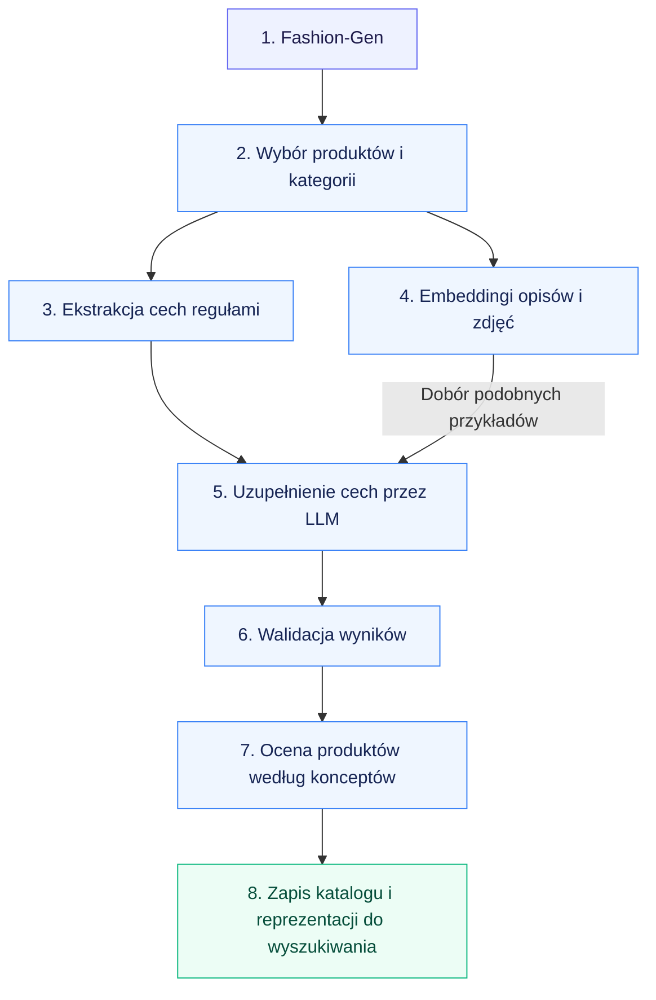
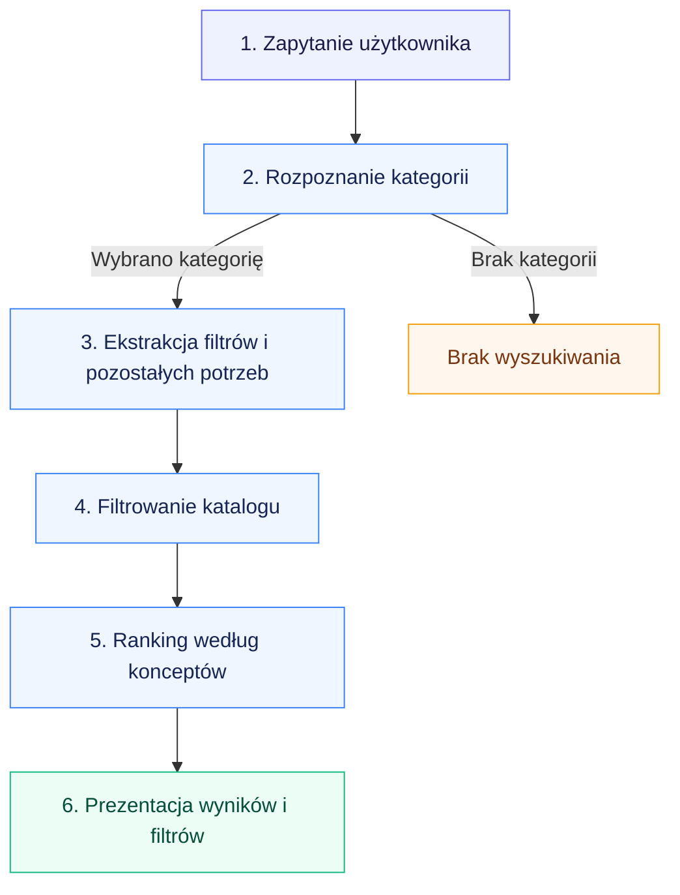

# Dokument etapu 2: Propozycja rozwiązania oraz analiza danych

**Projekt:** System wyszukiwania semantycznego w e-commerce z wykorzystaniem modeli językowych  
**Autorzy:** Jakub Rybak, Michał Sulowski  
**Promotor:** dr hab. Marcin Paprzycki  
**Data:** 03.11.2026  
**Wersja:** 1.0

| Wersja | Data | Opis zmiany |
| --- | --- | --- |
| 1.0 | 03.11.2026 | Propozycja rozwiązania, uzasadnienie technik i raport z analizy danych. |

Dokument rozwija specyfikację wymagań i zakres projektu z etapu 1. Przedstawia proponowane rozwiązanie, ocenę narzędzi i technik, założenia modelowania oraz wyniki wstępnej eksploracji i oceny jakości danych. Obejmuje również podział na moduły i wykonane przygotowanie danych.

## 1. Propozycja rozwiązania

System umożliwia wyszukiwanie odzieży na podstawie zapytań w języku naturalnym. Łączy jawne filtrowanie po cechach produktu z rankingiem uwzględniającym pozostałe potrzeby użytkownika. Przetwarzanie katalogu odbywa się offline, aby ograniczyć koszt i czas obsługi zapytań.

### Przygotowanie katalogu offline

| Blok | Wyjaśnienie |
| --- | --- |
| **1. Fashion-Gen** | Surowe pliki HDF5 zawierające zdjęcia produktów i dane tekstowe: nazwę, opis, skład, płeć oraz kategorie źródłowe. |
| **2. Wybór produktów i kategorii** | Ograniczenie zbioru do odzieży objętej projektem i przypisanie produktów do taksonomii projektu. Wiersze zdjęć są grupowane w produkty, zdjęcia eksportowane do plików, a podział train/validation pozostaje zachowany. |
| **3. Ekstrakcja cech regułami** | Przypisanie cech, np. koloru lub długości rękawa, przez dopasowanie fraz i wyrażeń regularnych w nazwie lub opisie. Płeć jest odczytywana z odpowiedniej kolumny, a skład ustalany przez parser materiałów i procentów. Szczegółowe reguły zależą od cechy i kategorii. |
| **4. Embeddingi opisów i zdjęć** | Obliczenie osobnych wektorów dla opisu i głównego zdjęcia produktu. Pozwalają znaleźć podobne, już oznaczone produkty do przykładów dla LLM. |
| **5. Uzupełnienie cech przez LLM** | Model analizuje nazwę, opis i zdjęcia produktu oraz dwa podobne oznaczone przykłady. Przypisuje wyłącznie brakujące cechy, wybierając z dozwolonych wartości. Przypisania reguł pozostają zachowane. |
| **6. Walidacja wyników** | Sprawdzenie kompletności, dozwolonych wartości i zależności między cechami. Błędy oraz nierozstrzygnięte przypadki otrzymują status wymagający dalszej obsługi. Walidacja techniczna nie zastępuje oceny trafności etykiet. |
| **7. Ocena produktów według konceptów** | Koncepty to zdefiniowane pojęcia opisujące potrzeby użytkownika, np. elegancja, przewiewność lub przydatność na wesele. Model przypisuje każdemu produktowi ocenę dopasowania do każdego konceptu w skali 0–1. Oceny oraz wektory reprezentujące koncepty są przygotowywane offline. |
| **8. Zapis katalogu i reprezentacji do wyszukiwania** | Zapis produktów z cechami, metadanymi przypisań i statusami, ocen dopasowania do konceptów oraz embeddingów. Dane są powiązane przez identyfikatory produktów i konceptów. Wyszukiwarka korzysta z produktów gotowych do wyszukiwania. |

### Obsługa zapytania

| Blok | Wyjaśnienie |
| --- | --- |
| **1. Zapytanie użytkownika** | Fraza w języku naturalnym, np. „czarna sukienka na wesele poniżej 200 dolarów”. |
| **2. Rozpoznanie kategorii** | Pierwsze wywołanie modelu wybiera dokładnie jedną obsługiwaną kategorię, np. Dresses. Jeśli nie można jej ustalić, wyszukiwanie nie jest wykonywane. |
| **3. Ekstrakcja filtrów i pozostałych potrzeb** | Drugie wywołanie modelu, ze schematem wybranej kategorii, rozpoznaje warunki, np. kolor Black i cenę poniżej 200. Część zapytania, której nie da się wyrazić dostępnymi filtrami, np. „na wesele”, jest zapisywana jako pozostałe potrzeby użytkownika i wykorzystywana do sortowania wyników. Parser obsługuje też wykluczenia oraz alternatywy wartości. |
| **4. Filtrowanie katalogu** | Kod wybiera produkty zgodne z kategorią i wszystkimi warunkami. Użytkownik może sprawdzić zastosowane filtry. System nie rozluźnia ich automatycznie; brak dopasowania może oznaczać pusty wynik. |
| **5. Ranking według konceptów** | Część zapytania, której nie opisują filtry, np. „na wesele”, jest zamieniana na reprezentację wektorową i porównywana z reprezentacjami zdefiniowanych konceptów. System wybiera najbliższe znaczeniowo koncepty i sortuje produkty według ich wcześniej obliczonych ocen dopasowania. Ranking zmienia kolejność wyników, zachowując produkty spełniające twarde warunki. |
| **6. Prezentacja wyników i filtrów** | Wyświetlenie uporządkowanych produktów, zdjęć, cen i dopasowanych cech. Interfejs pokazuje interpretację query i pozwala ręcznie zmienić filtry. |
| **Brak wyszukiwania** | Obsługa zapytania, dla którego nie ustalono kategorii: użytkownik nie otrzymuje wyników z przypadkowo wybranej kategorii. |

**Agent:** planowany moduł konwersacyjny korzystający z katalogu i narzędzi wyszukiwania. Ma rekomendować istniejące produkty i uzasadniać wybór. Szczegółowy mechanizm działania i jego przewaga nad samą wyszukiwarką wymagają dalszych eksperymentów.

## 2. Ocena narzędzi i technik

| Obszar | Wybrana technika i uzasadnienie | Ograniczenia |
| --- | --- | --- |
| Reguły ekstrakcji | Keywordy, wyrażenia regularne i parser składu. Pozwalają tanio i powtarzalnie przypisać cechy zapisane wprost w danych. | Opisy bywają niepełne, a dopasowana fraza może dotyczyć detalu zamiast całego produktu. |
| Uzupełnianie cech | Multimodalny Gemini 3.5 Flash-Lite analizuje tekst i zdjęcia, uzupełniając brakujące cechy. Wybrano go ze względu na stosunek jakości do kosztu. | Model może przypisać błędną wartość; odpowiedzi wymagają walidacji i oceny jakości. |
| Dobór przykładów | Gemini Embedding 2 wskazuje podobne produkty na podstawie opisu i głównego zdjęcia. Dwa oznaczone przykłady tej samej kategorii i płci stanowią kontekst dla ekstrakcji LLM. | Błędne etykiety przykładów mogą wpływać na kolejne przypisania. |
| Ranking | Produkty mają obliczone offline oceny dopasowania do konceptów, np. elegancji. System dobiera koncepty do potrzeb z zapytania i sortuje według tych ocen. | Jakość zależy od pokrycia potrzeb przez słownik konceptów i poprawności ocen produktów. |
| Prototyp GUI | Aplikacja WWW pozwala sprawdzić wyniki wyszukiwania, interpretację zapytania i ręcznie poprawić filtry. | Demonstrator wymaga dalszych testów użyteczności i wydajności. |

## 3. Założenia techniki modelowania

- System korzysta z gotowych modeli, bez trenowania lub dostrajania na własnych danych. Taksonomia kategorii i słowniki cech są zdefiniowane przez zespół.
- Produkt ma dokładnie jedną kategorię. Każda kategoria określa wymagane cechy, dozwolone wartości i ograniczenia, np. wybór pojedynczy lub wielokrotny.
- Ekstrakcja offline najpierw wykorzystuje dane źródłowe i reguły. LLM uzupełnia tylko brakujące cechy; nie nadpisuje wartości przypisanych przez keywordy. Prompty pomijają definicje i etykiety cech, które nie wymagają uzupełnienia.
- Jedno wywołanie dotyczy jednego produktu. Model otrzymuje jego nazwę, opis, dostępne zdjęcia oraz dwa oznaczone przykłady; każdy przykład dostarcza dwa zdjęcia.
- Model może zgłosić problem z całym produktem. Dla cechy bez `Other` może zgłosić `outside_schema` z uzasadnieniem. Jeśli `Other` jest dostępne, musi wybrać jedną z dopuszczonych wartości.
- Nieudana ekstrakcja płci, składu głównego lub brak marki wyklucza produkt z dalszego przetwarzania. Rekord pozostaje zapisany wraz z powodem. Pozostałe nierozstrzygnięte przypadki wymagają uzupełnienia albo przeglądu.
- Parser query wybiera dokładnie jedną kategorię albo zgłasza jej brak. Dla cech pojedynczych kilka żądanych wartości oznacza alternatywę. Dla wielowartościowych parser rozróżnia „dowolną”, „wszystkie”, „dokładnie te” i wykluczenia. Procenty materiałów nie są obecnie interpretowane jako progi filtrowania.
- Ranking opiera się na ustalonym słowniku konceptów. Oceny produktów są obliczane offline; podczas wyszukiwania dobierane są koncepty odpowiadające pozostałej intencji użytkownika, a ich oceny wyznaczają kolejność wyników.
- Prompty, definicje i przykłady dla modeli są po angielsku. Testy zapytań obejmują również język polski. Zbiór Amazon ESCI stanowi źródło rzeczywistych fraz do dalszej oceny parsera.

## 4. Raport danych: wstępna eksploracja

Źródłem katalogu jest Fashion-Gen: produkty SSENSE z angielskimi opisami i wieloma zdjęciami o rozdzielczości 256 × 256 px. W projekcie wykorzystywane są części train i validation. Rekordy HDF5 odpowiadają zdjęciom; przy przygotowaniu katalogu są grupowane według identyfikatora produktu.

| Zakres | Liczba produktów |
| --- | ---: |
| Pełny zbiór train i validation | 67 666 |
| Katalog odzieży po wyborze zakresu projektu | 52 969 |
| Katalog odzieży: train | 47 082 |
| Katalog odzieży: validation | 5 887 |
| Pilotaż ekstrakcji LLM: po 300 produktów z trzech kategorii | 900 |

Katalog projektu obejmuje 8 działów i 22 kategorie. Liczby poniżej dotyczą katalogu przed wykluczeniami wynikającymi z ekstrakcji cech.

| Dział | Produkty |
| --- | ---: |
| Tops | 10 689 |
| Shirts & Blouses | 5 341 |
| Sweaters | 12 105 |
| Jackets & Coats | 8 324 |
| Pants | 9 944 |
| Shorts | 2 053 |
| Skirts | 1 913 |
| Dresses | 2 600 |

Dostępne informacje obejmują nazwę, opis, markę, płeć, skład procentowy, kategorie źródłowe, cenę, sezon oraz zdjęcia. Dla wszystkich 52 969 produktów sprawdzono kolumny `name`, `description`, `composition`, `gender` i `brand`: nie znaleziono pustych ani zawierających wyłącznie białe znaki. Nie oznacza to, że treść każdej z tych kolumn jest poprawna lub kompletna znaczeniowo.

## 5. Raport danych: ocena jakości

| Obserwacja | Znaczenie dla rozwiązania | Postępowanie |
| --- | --- | --- |
| Jeden produkt występuje w wielu wierszach źródłowych. | Liczenie wierszy jako produktów zawyżałoby liczebność katalogu. | Grupowanie po `product_id`, osobny manifest zdjęć i zachowanie podziału train/validation. |
| Część opisów nie podaje wprost cech takich jak krój, długość czy dekolt. | Brak keyworda nie oznacza braku cechy. | Uzupełnianie przez model na podstawie tekstu i zdjęć. |
| Skład może zawierać kilka sekcji, nieznane materiały lub błędną sumę procentów. | Nie można bezwarunkowo potraktować całego pola jako składu głównego. | Wybór dopuszczonej sekcji, mapowanie materiałów i kontrola sumy 100%; zapis powodów niepowodzenia. |
| Keyword może opisywać detal, markę lub element innego ubrania. | Ryzyko fałszywego przypisania. | Dobór kolumn i fraz, maskowanie marki przy kolorach oraz przeglądy przykładów. Pattern przekazano w całości do LLM. |
| Zdjęcia mają małą rozdzielczość; ujęcia mogą przedstawiać całą stylizację. | Drobne detale bywają nieczytelne, a inne ubrania mogą zmylić model. | Analiza wielu zdjęć produktu; embedding wizualny wyłącznie z głównego zdjęcia. |
| Granice niektórych wartości, szczególnie fit i length, są subiektywne. | Rozbieżność ocen nie zawsze jest jednoznacznym błędem. | Jawne definicje, przykłady oraz oddzielne oznaczanie niejednoznaczności podczas oceny. |
| Brakuje rozmiarów, stanów magazynowych i historii zachowań użytkowników. | Nie można ocenić dostępności ani zbudować personalizacji na podstawie interakcji. | Zakres ograniczony do wyszukiwania i rankingu istniejącego katalogu. |

### Wynik pilotażu

Pilotaż obejmuje po 300 produktów z kategorii T-shirts, Dresses oraz Tank tops & Camisoles. Przygotowano 60 ręcznie oznaczonych przykładów początkowych, a dla pozostałych 840 produktów wykonano ekstrakcję LLM.

| Status końcowy | Produkty | Udział |
| --- | ---: | ---: |
| `ready` – komplet wymaganych cech i poprawna walidacja | 893 | 99,22% |
| `pending` – nierozstrzygnięta cecha | 4 | 0,44% |
| `needs_review` – problem techniczny lub wymagający sprawdzenia | 3 | 0,33% |

Wszystkie identyfikatory odpowiadają ustalonej próbce, przypisania keywordów zostały zachowane, a zapis JSONL i Parquet jest zgodny. Przypadki wymagające uwagi obejmowały m.in. nietypowe rękawy, kolor spoza słownika, niespójne zdjęcia, konflikt cech i błąd API.

**99,22% to kompletność zwalidowanych rekordów, a nie dokładność etykiet.** Przeglądy wskazały błędy i niejednoznaczności, ale nie stanowią kompletnego, niezależnego benchmarku trafności. Ta wartość nie stanowi dowodu poprawności 99,22% przypisań.

Dla pilotażu obliczono również 900 embeddingów zdjęć i 900 embeddingów opisów, po 3072 wymiary. Sprawdzono pokrycie identyfikatorów, wymiar, skończoność wartości i normalizację wektorów.

## 6. Moduły, GUI i przygotowanie danych

| Moduł | Odpowiedzialność |
| --- | --- |
| Przygotowanie katalogu | Odczyt HDF5, wybór kategorii, grupowanie produktów, eksport metadanych i zdjęć. |
| Ekstrakcja cech | Reguły YAML, parser składu, uzupełnianie przez LLM i walidacja wyników. |
| Embeddingi | Obliczanie i przechowywanie reprezentacji zdjęć oraz opisów. |
| Parser query | Rozpoznanie kategorii, filtrów, marki, ceny i residual. |
| Wyszukiwanie i ranking | Wykonanie filtrów, wybór konceptów odpowiadających zapytaniu i sortowanie według ocen produktów dla tych konceptów. |
| GUI | Wprowadzanie query, podgląd i edycja filtrów, lista wyników oraz szczegóły produktu. |
| Agent – planowany | Obsługa rozmowy i rekomendacje oparte na katalogu. |

Przygotowanie danych jest zaimplementowane: powstają osobne pliki produktów i manifesty zdjęć dla train oraz validation. Zdjęcia są eksportowane do plików i łączone z metadanymi przez identyfikatory. Wyniki ekstrakcji są zapisywane w JSONL i Parquet wraz z cechami, źródłem przypisań, statusem i powodami wykluczeń. Dane źródłowe pozostają zachowane.

Prototyp GUI pozwala wpisać query, zobaczyć interpretację parsera, zmienić filtry i przejrzeć zdjęcia oraz cechy wyników. Służy także do obserwowania czasu parsowania, filtrowania i rankingu.
